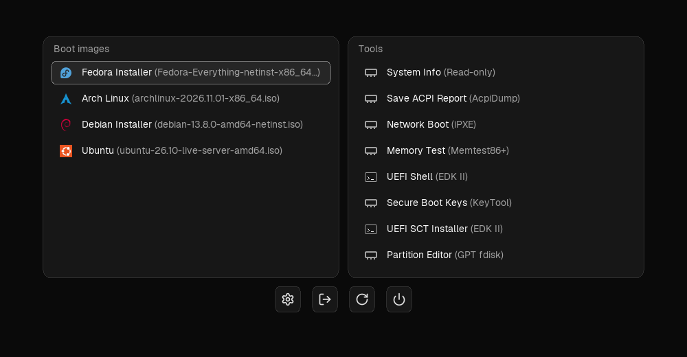
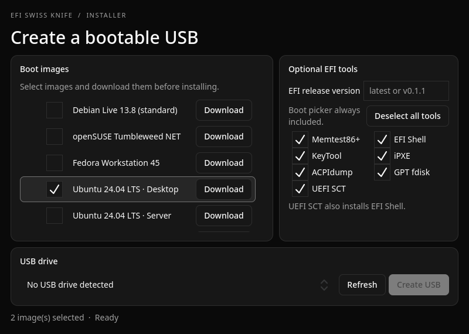

# EFI Swiss Knife

**Boot Linux ISOs and run EFI utilities from one USB drive.** EFI Swiss Knife
is a Rust boot menu for x86-64 UEFI, with a Linux desktop installer.

[Download the latest release](https://github.com/virtualWinter/efi-sk/releases/latest)
· [Set up a USB drive](docs/usb.md)
· [See supported ISOs](docs/profiles.md)

## EFI boot menu

The picker discovers supported ISOs in `iso/` on the `ISOS` ext4 partition
and lists the tools installed on the EFI partition. No configuration file is
needed. It uses a graphical menu when firmware supports it and falls back to
the text console otherwise.

## Linux desktop installer

Choose your boot images, pick an EFI release and optional tools, then select
the USB drive. The installer verifies the EFI bundle before asking for
administrator privileges. **Creating the USB erases the selected drive.**
See the [experimental installer guide](installer/README.md) for dependencies.

## Build and test

Run `tools/build-efi.sh` to produce `build/BOOTX64.EFI`. See the
[build guide](docs/build.md) for prerequisites or
[test with QEMU](docs/testing.md) without writing to a physical drive.

## License

Original code is licensed under the [ISC License](LICENSE). Bundled software,
fonts (including [Geist](assets/OFL-Geist.txt)), and artwork remain under
their own terms; see the [third-party notices](docs/third-party.md).

Ubuntu's [Circle of Friends](https://discourse.ubuntu.com/t/ubuntu-merchandise-assets/67314)
(registered by Canonical Ltd.) is read from the ISO's live system at boot,
and Arch Linux artwork is subject to the
[Arch Linux trademark policy](https://archlinux.org/art/).
